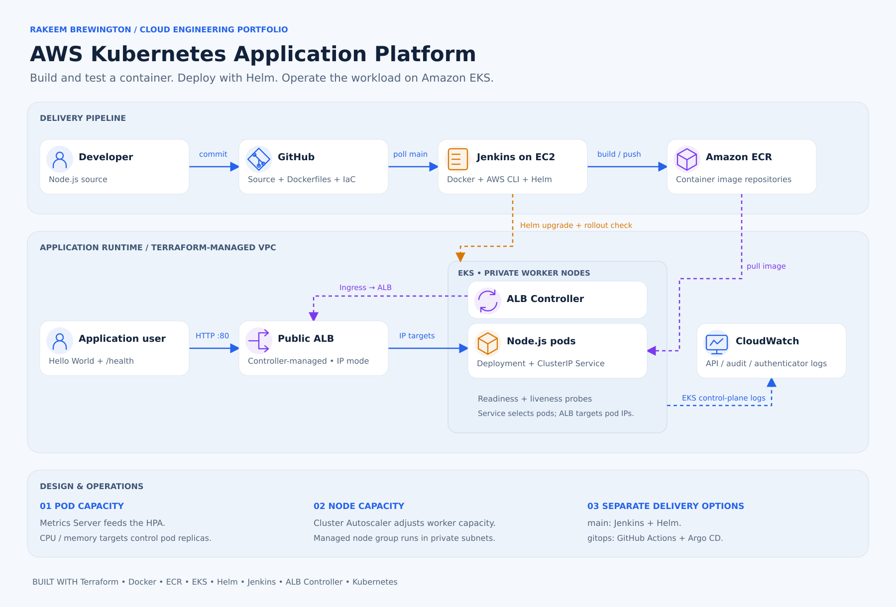
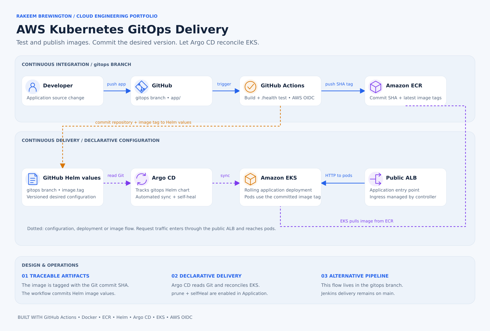

# AWS EKS — Kubernetes Deployment and GitOps

Application Deployment with Docker, Terraform, Amazon EKS, Helm, Jenkins, GitHub Actions, and Argo CD.

## Project at a glance

**Business scenario:** A team needs consistent Kubernetes deployments, a way to accommodate changing demand, and traceable changes to application configuration.

**Implementation:** Terraform defines the EKS environment, Docker packages a Node.js application, and Helm defines the Kubernetes deployment. The `main` branch contains the Jenkins delivery path; the separate `gitops` branch contains the GitHub Actions/Argo CD alternative.

**Implemented capabilities**

- Jenkins builds the image, checks `/health`, publishes build-number and `latest` tags to ECR, and deploys the build-number tag with Helm.
- The Helm chart defines health probes, container security settings, and CPU/memory-based pod autoscaling.
- The `gitops` branch contains an image build/push workflow and an Argo CD Application manifest. Repository references in that branch need updating before reuse; see [GitOps alternative](#gitops-alternative-github-actions-and-argo-cd).

These statements describe committed configuration. Current deployment health and load-test outcomes are not verified by the committed files.

**Key decisions:** Managed EKS separates Kubernetes control-plane operations from application delivery; Helm standardizes releases; GitOps improves traceability between Git configuration and cluster state.

**Production improvements to prioritize:** Explicit SLOs, dashboard-backed alerting, resilient multi-AZ capacity, least-privilege deployment access, and a documented rollback procedure.

**Stack:** AWS EKS · ECR · Terraform · Kubernetes · Docker · Helm · Jenkins · GitHub Actions · Argo CD

**Explore:** [Architecture](#architecture) · [Technology choices](#technologies) · [Source code](https://github.com/Rakeem08/aws-eks-kubernetes-gitops)

> **Portfolio environment:** The application URL below is a historical lab endpoint; it may no longer be reachable.

## Historical Application Endpoint

[Historical Hello World application URL](http://k8s-techchal-techchal-ce433c8d4f-1761637325.us-east-1.elb.amazonaws.com)

## Project Objective

This project demonstrates how to containerize a Node.js web application, create AWS infrastructure using Terraform, deploy the application to Amazon EKS with Helm, and automate deployments with Jenkins.

### Delivery paths

| Path | Implementation | Deployment behavior |
|---|---|---|
| Main workflow: Jenkins | [`Jenkinsfile`](Jenkinsfile) on `main` | Jenkins pushes to ECR and runs Helm directly against EKS. |
| Alternative: GitHub Actions + Argo CD | [`gitops` branch](https://github.com/Rakeem08/aws-eks-kubernetes-gitops/tree/gitops) | Actions publishes the image and commits Helm image values; Argo CD is configured to reconcile that branch into EKS. Setup corrections are listed below. |

The instructions below use `main` unless explicitly marked as GitOps. Use one deployment owner for the application: Jenkins and Argo CD should not both manage the same release.

The repository is public. The existing `tech-challenge-2` chart directory, Helm release, namespace, ECR repository, and AWS resource defaults are retained because the implementation still uses those identifiers. Renaming the GitHub repository does not rename deployed resources.

## Architecture



[Open the full-size architecture graphic](docs/images/eks-architecture.svg)

This diagram shows the `main` branch delivery path: Jenkins builds and health-tests the image, pushes it to ECR, and deploys a versioned tag with Helm. Ingress is reconciled by the AWS Load Balancer Controller; the ALB uses IP targets to reach application pods. The ClusterIP Service selects the pods but is not a separate ALB traffic hop in this configuration. Dotted arrows show deployment, image, or control-plane flow.

## Technologies

- Node.js and Express
- Docker
- Terraform
- Amazon ECR
- Amazon EKS
- Kubernetes
- Helm
- AWS Load Balancer Controller
- Kubernetes Metrics Server
- Kubernetes Cluster Autoscaler
- Jenkins
- GitHub Actions
- Argo CD

## Repository Structure

This tree shows the main Jenkins path. GitOps-only files are linked in the alternative workflow section.

```text
.
├── app/
│   ├── Dockerfile
│   ├── package.json
│   ├── package-lock.json
│   └── server.js
├── helm/
│   └── tech-challenge-2/
│       ├── Chart.yaml
│       ├── values.yaml
│       └── templates/
│           ├── deployment.yaml
│           ├── service.yaml
│           ├── ingress.yaml
│           └── hpa.yaml
├── terraform/
│   ├── ecr.tf
│   ├── eks.tf
│   ├── iam.tf
│   ├── jenkins.tf
│   ├── network.tf
│   ├── outputs.tf
│   ├── variables.tf
│   └── versions.tf
├── Jenkinsfile
└── README.md
```

## Web Application

The application is a small Express web server.

Available endpoints:

| Endpoint | Purpose |
|---|---|
| `/` | Returns `Hello, World!` |
| `/health` | Returns `OK` for container and Kubernetes health checks |

The server listens on port `3000` and binds to `0.0.0.0`, allowing it to run inside a Docker container.

## Prerequisites

Install and configure:

- Git
- Node.js and npm
- Docker Desktop
- Terraform 1.5.7 or newer
- AWS CLI version 2
- kubectl
- Helm
- An AWS account with appropriate permissions
- An EC2 key pair in `us-east-1`

Confirm the tools:

```powershell
git --version
node --version
npm --version
docker --version
terraform version
aws --version
kubectl version --client
helm version
```

Configure AWS CLI:

```powershell
aws configure
```

Confirm the AWS identity:

```powershell
aws sts get-caller-identity
```

## Clone the Repository

```powershell
git clone https://github.com/Rakeem08/aws-eks-kubernetes-gitops.git
cd aws-eks-kubernetes-gitops
```

## Run the Application Locally

Move into the application directory:

```powershell
cd app
```

Install dependencies:

```powershell
npm.cmd ci
```

Start the application:

```powershell
npm.cmd start
```

Test it:

```powershell
Invoke-WebRequest -UseBasicParsing http://localhost:3000
Invoke-WebRequest -UseBasicParsing http://localhost:3000/health
```

## Run with Docker

Build the image from the repository root:

```powershell
docker build -t aws-eks-gitops-app:local .\app
```

Start the container:

```powershell
docker run --detach `
  --name aws-eks-gitops-local `
  --publish 3000:3000 `
  aws-eks-gitops-app:local
```

Test the container:

```powershell
Invoke-WebRequest -UseBasicParsing http://localhost:3000
Invoke-WebRequest -UseBasicParsing http://localhost:3000/health
```

Remove the test container:

```powershell
docker rm --force aws-eks-gitops-local
```

## Terraform Infrastructure

Terraform provisions:

- A VPC across two Availability Zones
- Public and private subnets
- Internet Gateway
- NAT Gateway
- Amazon ECR repository
- Amazon EKS cluster
- EKS managed node group
- Jenkins EC2 server
- Security groups
- IAM roles and policies
- EKS Pod Identity associations

### EKS Configuration

The managed node group uses:

- Instance type: `t3.small`
- Minimum nodes: `1`
- Desired nodes: `1`
- Maximum nodes: `4`
- Amazon Linux 2023
- 30 GB disk size configured
- Node repair enabled

The nodes run in private subnets. The EKS API supports private and public access.

### Terraform Variables

Create `terraform/terraform.tfvars`:

```hcl
jenkins_key_name     = "YOUR_AWS_KEY_PAIR_NAME"
jenkins_allowed_cidr = "YOUR_PUBLIC_IP/32"
```

Do not commit this file. It is excluded by `.gitignore`.

### Deploy the Infrastructure

Initialize Terraform:

```powershell
terraform -chdir=terraform init
```

Format and validate:

```powershell
terraform -chdir=terraform fmt -check
terraform -chdir=terraform validate
```

Create a saved plan:

```powershell
terraform -chdir=terraform plan -out=tfplan
```

Review the plan carefully, then apply it:

```powershell
terraform -chdir=terraform apply tfplan
```

Configure kubectl:

```powershell
aws eks update-kubeconfig `
  --region us-east-1 `
  --name tech-challenge-2-eks
```

Confirm the node:

```powershell
kubectl get nodes
```

## Amazon ECR

The ECR repository stores the Docker images used by EKS.

Retrieve the repository URL:

```powershell
$ecrUrl = terraform -chdir=terraform output -raw ecr_repository_url
```

Retrieve the registry:

```powershell
$registry = $ecrUrl.Split("/")[0]
```

Authenticate Docker:

```powershell
$ecrPassword = aws ecr get-login-password --region us-east-1
docker login --username AWS --password $ecrPassword $registry
Remove-Variable ecrPassword
```

Build and push:

```powershell
docker build -t tech-challenge-2-app:latest .\app
docker tag tech-challenge-2-app:latest "${ecrUrl}:latest"
docker push "${ecrUrl}:latest"
```

## Kubernetes and Helm

Before deploying, complete the [supporting controller setup](#supporting-controllers-must-be-installed-separately) described below. Terraform does not install those controllers.

The Helm chart creates:

- Kubernetes Deployment
- ClusterIP Service
- ALB Ingress
- Horizontal Pod Autoscaler
- Readiness and liveness probes
- CPU and memory resource requests
- Non-root container security settings
- Pod topology spread rules

Validate the Helm chart:

```powershell
helm lint .\helm\tech-challenge-2
```

Deploy the chart:

```powershell
$ecrUrl = terraform -chdir=terraform output -raw ecr_repository_url

helm upgrade --install tech-challenge-2 `
  .\helm\tech-challenge-2 `
  --namespace tech-challenge-2 `
  --create-namespace `
  --set image.repository=$ecrUrl `
  --set image.tag=latest `
  --wait `
  --timeout=10m
```

Verify the deployment:

```powershell
kubectl get pods -n tech-challenge-2
kubectl get deployment -n tech-challenge-2
kubectl get service -n tech-challenge-2
kubectl get ingress -n tech-challenge-2
kubectl get hpa -n tech-challenge-2
```

## Autoscaling

### Pod Autoscaling

The Horizontal Pod Autoscaler uses:

- Minimum pods: `1`
- Maximum pods: `12`
- CPU target: `50%`
- Memory target: `50%`

The HPA ceiling is 12 pods. Actual capacity depends on node resources, system workloads, and scheduling constraints; the configuration does not guarantee three application pods per node. Topology spread uses `ScheduleAnyway`, so distribution across nodes is a preference.

### Node Autoscaling

Terraform defines managed-node-group scaling bounds and Cluster Autoscaler discovery tags. With a separately installed and configured Cluster Autoscaler, nodes can scale according to scheduling demand within these bounds:

- Minimum nodes: `1`
- Maximum nodes: `4`

Metrics Server must be installed separately to provide CPU and memory metrics to the HPA.

### Supporting Controllers Must Be Installed Separately

Terraform creates IAM policies and EKS Pod Identity associations for service accounts named `cluster-autoscaler` and `aws-load-balancer-controller` in `kube-system`. It does not install those controllers or Metrics Server, and this repository does not include their Helm installation commands or values.

Before expecting ALB creation or autoscaling, install compatible controller releases, use the service account names above, and configure the Cluster Autoscaler for the cluster. Verify these prerequisites before application deployment:

```powershell
kubectl get deployment -n kube-system
kubectl get serviceaccount cluster-autoscaler aws-load-balancer-controller -n kube-system
kubectl top nodes
```

An HPA manifest and node-group bounds alone do not demonstrate successful scaling.

## Application Load Balancer

The AWS Load Balancer Controller creates an internet-facing ALB from the Kubernetes Ingress.

Retrieve the public address:

```powershell
$albAddress = kubectl get ingress tech-challenge-2 `
  -n tech-challenge-2 `
  -o jsonpath="{.status.loadBalancer.ingress[0].hostname}"

"http://$albAddress"
```

## Jenkins Server

Terraform creates a Jenkins server on an Amazon Linux 2023 EC2 instance.

The startup script installs:

- Jenkins LTS
- Amazon Corretto Java 21
- Docker
- AWS CLI
- kubectl
- Helm
- Git

Ports `22` and `8080` use `jenkins_allowed_cidr`. Set this variable to the administrator’s `/32` public IP address; the Terraform validation checks CIDR syntax but does not enforce `/32`.

Retrieve the Jenkins public IP:

```powershell
$jenkinsIp = aws ec2 describe-instances `
  --region us-east-1 `
  --filters `
    "Name=tag:Name,Values=tech-challenge-2-jenkins" `
    "Name=instance-state-name,Values=running" `
  --query "Reservations[0].Instances[0].PublicIpAddress" `
  --output text

"http://${jenkinsIp}:8080"
```

Retrieve the initial unlock password from the server:

```powershell
ssh -i "PATH_TO_KEY_FILE" ec2-user@$jenkinsIp
```

```bash
sudo cat /var/lib/jenkins/secrets/initialAdminPassword
```

Do not commit passwords, private keys, or GitHub tokens.

## Jenkins Repository Access

This public repository can be checked out over HTTPS without a GitHub token. Leave the Jenkins SCM credential unset for anonymous read access.

If authenticated checkout is needed for a separate environment, use a read-only credential scoped to `Rakeem08/aws-eks-kubernetes-gitops` and keep the token in Jenkins Credentials. A GitHub checkout credential is separate from the EC2 IAM role used to access AWS.

## Jenkins Pipeline

The root `Jenkinsfile` performs:

1. Repository checkout
2. AWS and image preparation
3. Docker image build
4. Container health test
5. ECR authentication
6. Versioned image push
7. `latest` image push
8. Helm deployment to EKS
9. Kubernetes rollout verification
10. Workspace cleanup

Each build uses the Jenkins build number as the Docker image tag. The pipeline uses `helm lint`, `helm upgrade --install --atomic --wait`, and `kubectl rollout status`.

Create the `tech-challenge-2` namespace with an administrator identity before the first pipeline run. Jenkins has namespace-scoped access, and its Helm command does not include `--create-namespace`.

The pipeline configures SCM polling every five minutes. The job configuration below selects `main`.

### Create the Jenkins Job

Create a Jenkins Pipeline job with:

- Name: `aws-eks-kubernetes-gitops-pipeline`
- Definition: Pipeline script from SCM
- SCM: Git
- Repository:

```text
https://github.com/Rakeem08/aws-eks-kubernetes-gitops.git
```

- Credentials: none required for public read access
- Branch: `*/main`
- Script path: `Jenkinsfile`

Run **Build Now** and confirm:

```text
Finished: SUCCESS
```

## Security Features

- EKS worker nodes run in private subnets.
- Jenkins ports are restricted to the configured `jenkins_allowed_cidr` (use `/32` for one administrator IP).
- Jenkins uses an EC2 IAM role instead of stored AWS access keys.
- Jenkins receives namespace-scoped EKS access.
- Jenkins ECR image operations are scoped to the application repository; ECR authorization and EKS discovery use wildcard resources.
- Kubernetes containers run as a non-root numeric user.
- Linux capabilities are dropped from the application container.
- Health probes monitor the application.
- `.gitignore` excludes `.env`, `*.pem`, `terraform/*.tfvars`, Terraform state, and the listed plan-file patterns. It does not prevent every possible secret from being committed.

## Troubleshooting Notes

The implementation includes these configuration choices:

- **Non-root identity:** The Deployment specifies numeric UID/GID `1000` with `runAsNonRoot: true`, avoiding ambiguity from an image's named user.
- **Jenkins startup:** The startup script uses the existing `curl` command rather than installing the full package over Amazon Linux's `curl-minimal`.
- **EKS API connectivity:** Terraform adds TCP `443` access from the Jenkins security group to the EKS cluster security group. For a timeout, check DNS, routes, security groups, and kubeconfig; AWS authentication alone does not prove network reachability.

## GitOps Alternative: GitHub Actions and Argo CD

The alternative implementation is on the [`gitops` branch](https://github.com/Rakeem08/aws-eks-kubernetes-gitops/tree/gitops). It is separate from the main Jenkins workflow.

### Implementation and Flow

| File on `gitops` | Responsibility |
|---|---|
| [`.github/workflows/gitops-ci.yml`](https://github.com/Rakeem08/aws-eks-kubernetes-gitops/blob/gitops/.github/workflows/gitops-ci.yml) | Build the image, check the container's `/health` endpoint, publish SHA and `latest` tags to ECR, and commit updated Helm image values. |
| [`terraform/github-actions.tf`](https://github.com/Rakeem08/aws-eks-kubernetes-gitops/blob/gitops/terraform/github-actions.tf) | Define the GitHub OIDC provider, IAM role, and ECR permissions. |
| [`argocd/application.yaml`](https://github.com/Rakeem08/aws-eks-kubernetes-gitops/blob/gitops/argocd/application.yaml) | Define Argo CD reconciliation of `helm/tech-challenge-2` from `gitops`, with automated prune, self-heal, and namespace creation. |

1. A push to `gitops` affecting `app/**` or the workflow file triggers CI; manual dispatch is also configured.
2. The workflow requests temporary AWS credentials using OIDC and the repository variable `AWS_ROLE_ARN`.
3. It builds the Docker image, runs a container health check, and pushes commit-SHA and `latest` tags.
4. It updates `image.repository` and `image.tag` in `helm/tech-challenge-2/values.yaml` and pushes a commit back to `gitops`.
5. An installed Argo CD instance with the Application applied is configured to reconcile the chart into EKS. Actions does not run Helm against the cluster.

### Current Setup Gaps

The files exist, but the current branch still contains references from before the repository rename:

- `argocd/application.yaml` uses the old clone URL. Set `spec.source.repoURL` to `https://github.com/Rakeem08/aws-eks-kubernetes-gitops.git` before applying it.
- The OIDC trust subject in `terraform/github-actions.tf` uses an outdated repository pattern with `@*` segments. For this repository's `gitops` branch, it must match `repo:Rakeem08/aws-eks-kubernetes-gitops:ref:refs/heads/gitops`.
- Configure `AWS_ROLE_ARN` with the role ARN, allow the workflow to write Helm values back to the branch, and install Argo CD separately before applying the Application.

These corrections and environment setup are prerequisites. The presence of workflow and Application files does not verify a successful CI run, an installed Argo CD instance, or a healthy synchronized deployment.

### GitOps Architecture



[Open the full-size GitOps graphic](docs/images/gitops-architecture.svg)

The graphic shows the configured alternative flow after the prerequisites above are satisfied.

## Cleanup

AWS resources generate charges while they are running.

For the Jenkins/manual Helm path, remove the application first:

```powershell
helm uninstall tech-challenge-2 -n tech-challenge-2
```

For the GitOps path, disable Argo CD reconciliation before deleting application resources so self-heal does not recreate them. Review the Application's deletion behavior and remove its managed workloads.

Wait for the ALB to be deleted, then remove any supporting Helm releases you installed (adjust names to match your environment):

```powershell
helm uninstall aws-load-balancer-controller -n kube-system
helm uninstall cluster-autoscaler -n kube-system
helm uninstall metrics-server -n kube-system
```

### Destroy the Terraform infrastructure

```powershell
terraform -chdir=terraform plan -destroy -out=destroy.tfplan
terraform -chdir=terraform apply destroy.tfplan
```

## Implementation Status

Checked items indicate source/configuration present, not a currently running AWS deployment.

- [x] Public repository: `Rakeem08/aws-eks-kubernetes-gitops`
- [x] Node.js application and Dockerfile
- [x] Terraform definitions for ECR, EKS, networking, Jenkins, and controller IAM access
- [x] Helm Deployment, Service, ALB Ingress, health probes, and CPU/memory HPA
- [x] Jenkins pipeline on `main`
- [x] Separate `gitops` branch
- [x] GitHub Actions build, health-check, ECR-push, and Helm-values update workflow on `gitops`
- [x] Argo CD Application manifest on `gitops`
- [ ] Correct the GitOps repository URL and OIDC trust subject for the renamed repository
- [ ] Verify GitOps end to end after those corrections and environment setup
